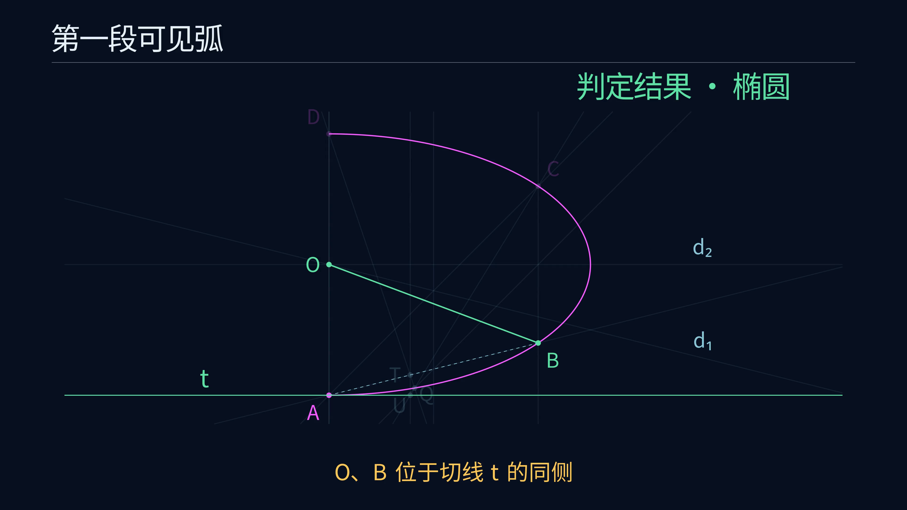

# Euclid-Conic-Classification · Straightedge-and-Compass Classification of a Conic Arc

[简体中文](README.md) · **English**

**Classify a given conic arc as an ellipse, a parabola or a hyperbola using the geometric positions of parallel chords, diameters and a tangent.**

The input is promised to lie on a nondegenerate real conic, with circles excluded by the problem definition. This project provides a finite straightedge-and-compass decision procedure covering the entire input domain, complete proofs, exact SageMath replays and a step-by-step animation. Arbitrarily short and long arcs, vertices and symmetric configurations are covered. The present goal is complete classification with reproducible verification. Move-count minimization is deferred.

[Watch the 4K60 construction](https://raw.githubusercontent.com/lenovobenben/euclid-conic-classification/main/animations/classification/media/ConicClassification_4k60.mp4) · [Complete construction](docs/ANSWER.md) · [Correctness proof](docs/PROOF.md) · [SageMath verification](experiments/verify.py)

[](https://raw.githubusercontent.com/lenovobenben/euclid-conic-classification/main/animations/classification/media/ConicClassification_4k60.mp4)

*Click the preview to view or download the animation, 3840 × 2160, 60 fps, 75.35 seconds.*

## Explore the construction

| Animation | Video | Target |
|---|---|---|
| Classifying a conic arc | [4K60 MP4](https://raw.githubusercontent.com/lenovobenben/euclid-conic-classification/main/animations/classification/media/ConicClassification_4k60.mp4) | Independent complete construction and classification examples for an ellipse, a parabola and a hyperbola |

The video has Chinese captions and follows Euclid-CCC-Min's dark-blue background and fine-line style. Magenta denotes the input arc and initial points, gold the current construction, pale blue auxiliary objects, and green the objects involved in the final decision and the resulting category.

One opening page summarizes the principle. The remainder shows parallel chords, chord midpoints, two diameters, the center and a tangent. Midpoints and parallels use standard straightedge-and-compass macros, with some routine auxiliary circles omitted. Detailed reasoning is provided in the documents.

Geometry is exported after exact verification, and Manim checks its data hash when loading. Both central-conic examples use a parallel branch of the five-point tangent construction. The ellipse example explicitly identifies the existing midpoint $M_2$ with the center $O$. See the [animation guide](animations/classification/README.md) for the storyboard, construction-order tests and rendering.

## Current classification results and scope

| Constructed relation | Classification |
|---|---|
| The two diameters are parallel | Parabola |
| The diameters meet, and the center $O$ and arc point $B$ lie on the same side of tangent $t$ | Ellipse |
| The diameters meet, and $O,B$ lie on opposite sides of $t$ | Hyperbola |

### Construction outline

Select four distinct points $A,B,C,D$ in arc order.

1. Through the midpoint of $AB$, draw a parallel to $AC$ and obtain its two intersections with the visible arc. Join the midpoints of the two parallel chords to obtain diameter $d_1$.
2. Reuse the midpoint of $AC$, draw a parallel to $AD$ and obtain the second diameter $d_2$ in the same way.
3. If the diameters are parallel, output parabola.
4. If they meet, obtain the center $O$. Use five already available points to construct tangent $t$ at $A$.
5. Compare the sides of $t$ containing $O$ and $B$, and output ellipse or hyperbola.

Every point is obtained by point selection, intersection or midpoint construction from available objects. The final category follows from point-line positions. [Complete construction](docs/ANSWER.md) · [Five-point tangent and parallel branches](docs/CONSTRUCTION.md)

### Why the procedure covers the full domain

Every choice of four distinct points in arc order works. Midpoint guides guarantee exactly two visible intersections for each auxiliary parallel, and the two chord directions differ automatically. For a central conic the two diameters meet uniquely at its center. For a parabola they are distinct and parallel.

The five-point tangent construction has explicit finite steps for finite auxiliary intersections, one parallel pair, two parallel pairs and a parallel final step. The tangent-side test gives strictly different outcomes for ellipses and hyperbolas. The three outputs are mutually exclusive and exhaust the promised input domain. [General proof](docs/PROOF.md) · [Special configurations and coverage](docs/CASES.md)

## Problem and straightedge-and-compass operations

The input is a nonzero connected arc, promised to belong to a noncircular ellipse, a parabola or a hyperbola. Endpoints may be unmarked. Vertices and symmetry are allowed. A connected hyperbola arc lies on one branch.

Selecting four distinct points in arc order and obtaining intersections of specified lines with the visible arc are allowed. The remaining elementary operations draw a line through two existing points, draw a circle centered at an existing point through another, and obtain finite real intersections of lines and circles. The tools follow the preceding four projects' unmarked-straightedge and collapsing-compass semantics.

Midpoints, perpendiculars and parallels use classical constructions. Exact parallelism, incidence, equality and line-order relations select branches. A side comparison can also be performed by joining the two points and checking whether its intersection with the tangent lies between them.

Coordinates in the proofs and replays explain geometric relations. The actual procedure follows the point-line construction steps. See [DESIGN](docs/DESIGN.md) for the full input and operation model.

## Sources and project contribution

The problem and initial parallel-chord midpoint and diameter ideas come from the author's original “圆锥曲线作图判定” exchange in `ai-math-notes`. The historical conversation and corrections are preserved with attribution. [Original exchange](sources/original_conic_qa.md) · [Source ledger](docs/LITERATURE.md)

This project supplies fixed midpoint guides and a finite-existence proof for selecting the parallel chords. It then uses the classical degenerate Pascal theorem to construct a tangent and completes the unified arbitrary-arc classification through side relations. The deliverables include a full-domain proof, all parallel branches, independent exact verification and a construction animation.

Five-point interpolation and discriminant classification are preserved as another theoretical and verification route in [algebraic verification](docs/ALGEBRA.md) and the [constructible-arithmetic appendix](docs/ARITHMETIC.md). The diameter, Pascal and conic-classification theories are classical. See [LITERATURE](docs/LITERATURE.md) for sources and contribution boundaries.

## Exact verification

Formal decisions use rational numbers, polynomial rings and the exact real algebraic field `AA` in SageMath 10.7. The geometric replay constructs chord intersections, midpoints, diameters, centers and tangents. Each constructed tangent is independently compared with the exact gradient line of the source conic.

| Check | Result | Entry point or record |
|---|---|---|
| General geometric identities | Four passed, including the midpoint and degenerate Pascal relations | [Geometric verification](experiments/verify_geometry.py) |
| Geometric decision procedure | 16 fixture families and 160 ordered-quadruple and reversal checks passed | [Verification report](experiments/results/verification.json) |
| Five-point tangents | 388 passed, with exact checks for all five branch types | [Geometric verification](experiments/verify_geometry.py) |
| Independent algebraic route | 18 identities and interpolation witnesses, plus 1,920 point permutations passed | [Five-point classification and independent equation recovery](experiments/conic_classifier.py) |
| Arithmetic appendix and invalid inputs | 95 arithmetic checks passed, with zero-divisor and five invalid-input rejections | [Unified verification entry point](experiments/verify.py) |
| Animation actions and display geometry | Three regression groups passed, checking parent-object order, tangent branches and screen incidence | [Animation tests](animations/classification/test_classification.py) |

Fixtures include tiny arcs with parameter spacing $10^{-12}$ and near-parabolic conics with parameters $\pm10^{-30}$. General proofs establish full-domain coverage. Exact fixtures and animation checks verify the implementation and presentation. [Verification layers](docs/VERIFICATION.md)

## Reproduction

Run the verification with SageMath 10.7 from the project root. The following command uses a pinned Docker image, read-only mounting and disabled networking on macOS/Linux.

```sh
docker run --rm --network none \
  -e PYTHONDONTWRITEBYTECODE=1 \
  -v "$PWD:/workspace:ro" -w /workspace \
  sagemath/sagemath@sha256:4f5589eb6c565949a006f8665de2876b8414410daf5ac554f4434a15d4f3d528 \
  sage -python experiments/verify.py
```

The expected exit status is zero, with these report fields.

```json
{
  "valid": true,
  "sage_version": "10.7",
  "fixture_count": 16,
  "point_permutation_count": 1920,
  "geometric_solution": {
    "construction_count": 160,
    "tangent_count": 388
  }
}
```

With SageMath installed, run `sage -python experiments/verify.py` directly. Windows PowerShell commands, report regeneration and environment details are in [REPRODUCING](docs/REPRODUCING.md).

Animation-action regression tests use a Manim environment.

```sh
docker run --rm --network none \
  -e PYTHONDONTWRITEBYTECODE=1 \
  -v "$PWD:/manim:ro" -w /manim \
  euclid-min-manim:0.21.0 \
  python -m unittest discover -s animations/classification -p 'test_*.py' -v
```

See the [animation guide](animations/classification/README.md) for building the Manim image, exporting geometry, rendering a 720p30 preview and producing the 4K60 video.

## Documentation and code

Detailed research documents are primarily in Chinese. The Chinese and English READMEs provide corresponding problem statements, results, scope and reproduction entry points.

| Topic | Entry point |
|---|---|
| Inputs, output, tools and allowed operations | [DESIGN](docs/DESIGN.md) |
| Complete geometric construction | [ANSWER](docs/ANSWER.md) |
| Five-point tangent and all parallel branches | [CONSTRUCTION](docs/CONSTRUCTION.md) |
| Correctness, coverage and termination | [PROOF](docs/PROOF.md) |
| Special configurations and branch classification | [CASES](docs/CASES.md) |
| Algebraic principles and independent verification | [ALGEBRA](docs/ALGEBRA.md), [ARITHMETIC](docs/ARITHMETIC.md) |
| Verification layers, results and full commands | [VERIFICATION](docs/VERIFICATION.md), [REPRODUCING](docs/REPRODUCING.md) |
| Historical materials, original ideas and contributions | [LITERATURE](docs/LITERATURE.md), [sources](sources/README.md) |
| Geometric classifier and exact replay | [geometric_classifier.py](experiments/geometric_classifier.py), [verify.py](experiments/verify.py) |
| Animation data, storyboard, tests and rendering | [Animation directory](animations/classification/README.md) |

**Euclid geometry research series**

[Euclid-Min](https://github.com/lenovobenben/euclid-min) · [Euclid-CCC-Min](https://github.com/lenovobenben/euclid-ccc-min) · [Euclid-Equal-Angle-Min](https://github.com/lenovobenben/euclid-equal-angle-min) · [Euclid-Castillon-Min](https://github.com/lenovobenben/euclid-castillon-min) · **Euclid-Conic-Classification**

## License and citation

Software, tests, build scripts and configuration use [Apache 2.0](LICENSE). Original mathematical documents, verification records, research data and animations use [CC BY 4.0](LICENSE-CONTENT). Historical snapshots, third-party materials and external dependencies retain their respective rights and licenses. See the [license scope](LICENSE-SCOPE.md).

When citing this project, credit **lenovobenben, Euclid-Conic-Classification**, link to the [repository](https://github.com/lenovobenben/euclid-conic-classification), and identify the commit or version used. Attribute and mark changes to redistributed or adapted non-software material under CC BY 4.0.
