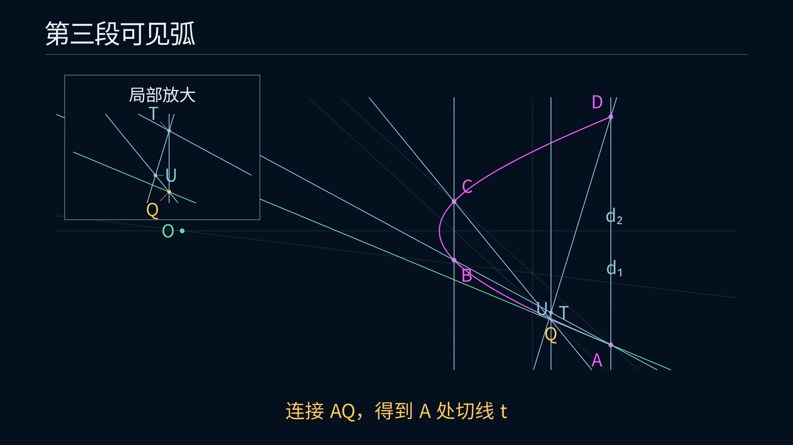

# Euclid-Conic-Classification · 圆锥曲线弧的尺规判定

**简体中文** · [English](README.en.md)

**给定一段圆锥曲线弧，用平行弦、直径和切线的几何位置，判定它属于椭圆、抛物线还是双曲线。**

输入已知属于非退化实圆锥曲线，圆按题面约定排除。本项目给出覆盖全部合法输入的有限尺规判定流程、完整证明、SageMath 精确重放和逐步动画。任意长短、含顶点及对称的可见弧均在范围内。当前以完整判定与可复现验证为目标，最小步数研究暂缓。

[观看 4K60 作图动画](https://raw.githubusercontent.com/lenovobenben/euclid-conic-classification/main/animations/classification/media/ConicClassification_4k60.mp4) · [完整作图答案](docs/ANSWER.md) · [正确性证明](docs/PROOF.md) · [SageMath 核验](experiments/verify.py)

[](https://raw.githubusercontent.com/lenovobenben/euclid-conic-classification/main/animations/classification/media/ConicClassification_4k60.mp4)

*点击预览图查看或下载动画，3840 × 2160，60 fps，79.55 秒。*

## 先看演示

| 动画 | 成片 | 完成的目标 |
|---|---|---|
| 圆锥曲线弧的类型判定 | [4K60 MP4](https://raw.githubusercontent.com/lenovobenben/euclid-conic-classification/main/animations/classification/media/ConicClassification_4k60.mp4) | 独立演示椭圆、抛物线、双曲线三个案例的完整作图与分类 |

动画使用中文字幕，沿用 Euclid-CCC-Min 的深蓝背景与细线风格。洋红表示输入弧及初始点，金色表示当前作图，淡蓝表示辅助对象，绿色表示判定相关对象和最终类别。

开头一页简述原理，随后连续演示平行弦、弦中点、两条直径、中心与切线。中点和平行线采用通常尺规宏，部分标准辅助圆省略。详细原理在专门文档中展开。

几何数据由正式精确重放导出，Manim 加载时核对数据哈希。两个中心型案例采用五点切线的平行分支，切线作成后局部放大 $U,T,Q$ 并以引线明确标签归属。椭圆案例还明确标注已有中点 $M_2$ 与中心 $O$ 重合。分镜、动作顺序检查和重新渲染见 [动画说明](animations/classification/README.md)。

## 当前判定结果与范围

| 作图得到的关系 | 曲线类别 |
|---|---|
| 两条直径平行 | 抛物线 |
| 两直径相交，中心 $O$ 与弧上点 $B$ 位于切线 $t$ 同侧 | 椭圆 |
| 两直径相交，$O,B$ 位于切线 $t$ 异侧 | 双曲线 |

### 作图主线

沿可见弧依次选取四个不同点 $A,B,C,D$。

1. 过 $AB$ 的中点作 $AC$ 的平行线，取得可见弧上的两个交点。连接这两条平行弦的中点，得到直径 $d_1$。
2. 复用 $AC$ 的中点，作 $AD$ 的平行线，同样取得另一条直径 $d_2$。
3. 两条直径平行时，输出抛物线。
4. 两条直径相交时，取得中心 $O$。利用已有五点，作出 $A$ 处切线 $t$。
5. 比较 $O,B$ 相对于 $t$ 的同侧或异侧关系，输出椭圆或双曲线。

各点由已有图形的取点、求交和中点构造取得，最终类别由点线位置关系给出。[完整答案](docs/ANSWER.md) · [五点切线及平行分支](docs/CONSTRUCTION.md)

### 为什么覆盖全部输入

任意四个按弧次序排列的不同点均可使用。中点引导保证两条辅助平行线都在可见弧内恰交两次，两组弦的方向自动不同。中心型曲线的两条直径唯一交于中心，抛物线的两条直径平行且不同。

五点切线构造对辅助线相交、单对平行、两对平行及最后一步平行分别规定有限作法。切线侧别判据对椭圆和双曲线给出严格不同的结果。三种输出互斥并覆盖全部题面输入。[一般证明](docs/PROOF.md) · [特殊情形与分支覆盖](docs/CASES.md)

## 题目与尺规操作

给定一段非零长度的连通弧，已知所属曲线为非圆椭圆、抛物线或双曲线之一。弧端点可以未标记，弧可包含顶点，也可具有对称性。双曲线的可见连通弧位于同一分支。

允许沿弧按次序选取四个不同点，并取得指定直线与可见弧的交点。其余基础操作为两点连线、以已有点为圆心经过另一点画圆，以及直线和圆的有限实交点。采用与前四个项目一致的无刻度直尺和塌圆规语义。

中点、垂线和平行线使用经典尺规构造。精确平行、相交、相等和直线次序关系用于选择分支。同侧判断还可通过连接两点，检查该线与切线的交点是否介于二点之间完成。

证明和核验中的坐标负责解释图形关系，实际作图按点线步骤实施。完整输入、允许操作及精确判断规则见 [DESIGN](docs/DESIGN.md)。

## 来源与项目贡献

题目以及平行弦中点、直径的初始思路来自作者在 `ai-math-notes` 中的“圆锥曲线作图判定”问答。原始材料与后续纠错按原样保存，来源及个人作法分别记录。[原始问答](sources/original_conic_qa.md) · [来源台账](docs/LITERATURE.md)

本项目以固定的中点引导补齐平行弦的取点规则与有限性证明，再利用经典退化帕斯卡定理作切线，通过侧别关系完成任意长短弧的统一判定。项目提供全域证明、全部平行分支、独立精确核验及作图动画。

五点插值与判别量分类保留为另一套原理和核验依据，分别写入 [代数核验](docs/ALGEBRA.md) 与 [尺规算术附录](docs/ARITHMETIC.md)。所用直径、帕斯卡及圆锥曲线分类理论均为经典内容，具体来源和贡献范围见 [LITERATURE](docs/LITERATURE.md)。

## 精确验证

正式判断使用 SageMath 10.7 的有理数、多项式环和实代数数域 `AA`。几何重放取得弦交点、中点、直径、中心和切线，所作切线再与原始曲线的精确梯度直线独立比较。

| 核验 | 结果 | 入口或记录 |
|---|---|---|
| 几何一般恒等式 | 4 项通过，包含平行弦中点与退化帕斯卡关系 | [几何核验](experiments/verify_geometry.py) |
| 几何主流程 | 16 类输入，共 160 次四点选择及反向次序通过 | [正式报告](experiments/results/verification.json) |
| 五点切线 | 388 次通过，全部五类分支有精确检查 | [几何核验](experiments/verify_geometry.py) |
| 独立代数核验 | 18 项恒等式与插值见证、1,920 种点名排列通过 | [五点判定与独立方程恢复](experiments/conic_classifier.py) |
| 尺规算术附录与非法输入对照 | 95 项算术检查通过，零除数及 5 项非法输入被拒绝 | [统一核验入口](experiments/verify.py) |
| 动画动作与显示几何 | 4 组回归测试通过，检查父对象顺序、切线分支、近点标注及屏幕与放大图的点线关联 | [动画测试](animations/classification/test_classification.py) |

案例包括参数间距 $10^{-12}$ 的短弧，以及参数为 $\pm10^{-30}$ 的近抛物线曲线。全域覆盖由一般证明保证，精确案例和动画检查用于核对程序实现与展示。[核验层次说明](docs/VERIFICATION.md)

## 复现

在项目根目录使用 SageMath 10.7 运行核验。下面采用固定 Docker 镜像、只读挂载和断网环境，适用于 macOS/Linux。

```sh
docker run --rm --network none \
  -e PYTHONDONTWRITEBYTECODE=1 \
  -v "$PWD:/workspace:ro" -w /workspace \
  sagemath/sagemath@sha256:4f5589eb6c565949a006f8665de2876b8414410daf5ac554f4434a15d4f3d528 \
  sage -python experiments/verify.py
```

预期退出码为零，报告包含以下字段。

```json
{
  "valid": true,
  "sage_version": "10.7",
  "fixture_count": 16,
  "point_permutation_count": 1920,
  "geometric_solution": {
    "construction_count": 160,
    "tangent_count": 388
  }
}
```

安装了 SageMath 的环境可直接运行 `sage -python experiments/verify.py`。Windows PowerShell 命令、报告再生成和环境说明见 [REPRODUCING](docs/REPRODUCING.md)。

动画动作回归测试使用 Manim 环境。

```sh
docker run --rm --network none \
  -e PYTHONDONTWRITEBYTECODE=1 \
  -v "$PWD:/manim:ro" -w /manim \
  euclid-min-manim:0.21.0 \
  python -m unittest discover -s animations/classification -p 'test_*.py' -v
```

Manim 镜像的构建、几何导出、720p30 预览与 4K60 渲染命令见 [动画说明](animations/classification/README.md)。

## 文档与代码入口

详细研究文档以中文为主，中英文 README 提供对应的题目、结果、范围及复现入口。

| 内容 | 入口 |
|---|---|
| 输入、目标、工具和允许操作 | [DESIGN](docs/DESIGN.md) |
| 完整几何作图流程 | [ANSWER](docs/ANSWER.md) |
| 五点切线与全部平行分支 | [CONSTRUCTION](docs/CONSTRUCTION.md) |
| 正确性、覆盖性与终止性 | [PROOF](docs/PROOF.md) |
| 特殊位置与分支分类 | [CASES](docs/CASES.md) |
| 代数原理与独立核验 | [ALGEBRA](docs/ALGEBRA.md)、[ARITHMETIC](docs/ARITHMETIC.md) |
| 验证层次、结果与完整命令 | [VERIFICATION](docs/VERIFICATION.md)、[REPRODUCING](docs/REPRODUCING.md) |
| 历史材料、原始思路与贡献范围 | [LITERATURE](docs/LITERATURE.md)、[sources](sources/README.md) |
| 几何主判定与精确重放 | [geometric_classifier.py](experiments/geometric_classifier.py)、[verify.py](experiments/verify.py) |
| 动画数据、分镜、测试与渲染 | [动画目录](animations/classification/README.md) |

**Euclid 几何研究系列**

[Euclid-Min](https://github.com/lenovobenben/euclid-min) · [Euclid-CCC-Min](https://github.com/lenovobenben/euclid-ccc-min) · [Euclid-Equal-Angle-Min](https://github.com/lenovobenben/euclid-equal-angle-min) · [Euclid-Castillon-Min](https://github.com/lenovobenben/euclid-castillon-min) · **Euclid-Conic-Classification**

## 许可与引用

代码、测试、构建脚本和配置采用 [Apache 2.0](LICENSE)。原创数学文档、核验记录、研究数据和动画采用 [CC BY 4.0](LICENSE-CONTENT)。来源快照、第三方材料和外部依赖保持各自的权利与许可，详见 [许可范围](LICENSE-SCOPE.md)。

引用本项目时请注明 **lenovobenben，Euclid-Conic-Classification**、[仓库地址](https://github.com/lenovobenben/euclid-conic-classification)及所用提交或版本。转载或改编非软件内容时按 CC BY 4.0 署名并注明修改。
