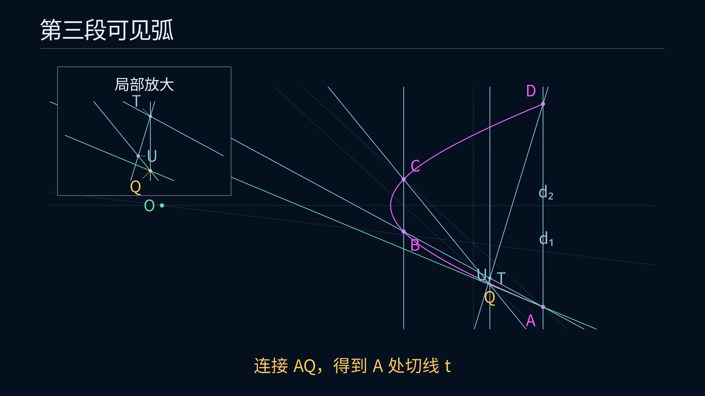

# 圆锥曲线弧的尺规作图动画

[观看 4K60 正式版](media/ConicClassification_4k60.mp4)

正式成片为 3840 × 2160、60 fps，时长 79.55 秒，文件约 12.47 MB。



## 1. 展示范围

开头一页简述原理，此后连续展示实际作图过程与三个分类结果。画面内容为弧、点、连线、平行弦、中点、直径、切线以及侧别关系。

中点和平行线采用通常尺规宏，部分标准辅助圆省略。完整原理和通解证明见 [PROOF](../../docs/PROOF.md)，五点切线的全部分支见 [CONSTRUCTION](../../docs/CONSTRUCTION.md)。

沿用前四个项目的深蓝背景、中文说明、细线和颜色角色。洋红表示输入弧及初始点，金色表示当前动作，淡蓝表示已有辅助对象，绿色表示最终相关对象和类别。

## 2. 作图分镜

| 阶段 | 实际画面 |
|---|---|
| 一页原理 | 平行弦中点、直径关系和切线 $t$ 侧别的简述，椭圆、双曲线分成两行 |
| 每个案例开始 | 在可见弧上依次标出 $A,B,C,D$ |
| 第一组平行弦 | 作 $AB$ 中点，过它画 $AC$ 平行线，标出 $U,V$，连接两弦中点 |
| 第二组平行弦 | 复用 $AC$ 中点，画 $AD$ 平行线，标出 $W,X$，连接两弦中点 |
| 抛物线分支 | 高亮两条平行直径，给出类别 |
| 中心型分支 | 标出两直径交点 $O$ |
| 五点切线 | 逐条连接辅助线，遇平行关系时展示对应过点平行线，作出 $A$ 处切线，再局部放大 $U,T,Q$ |
| 椭圆或双曲线 | 连接 $OB$，观察 $O,B$ 相对于切线 $t$ 的同侧、异侧关系，给出类别 |

三个案例独立地从给定弧开始。主流程在 [ANSWER](../../docs/ANSWER.md) 中逐步列出。

## 3. 精确数据

[geometry.json](geometry.json) 由 `experiments/verify.py --write` 导出。它保存实际作图点线、两组平行弦、直径、中心、切线辅助交点和精确分支得到的类别。

五点切线与原始曲线梯度直线独立核对。全部 723 个显示弧采样点通过曲线方程检查，随后转为屏幕坐标。Manim 加载文件时核对验证报告中的 SHA-256。

## 4. 重放和渲染

在项目根目录运行。先生成已验证数据，再渲染预览或正式版。

首次准备 Manim 环境时，可从本目录 Dockerfile 构建带 Noto Sans CJK SC 字体的镜像。

```sh
docker build -t euclid-min-manim:0.21.0 animations/classification
```

```powershell
docker run --rm --network none -e PYTHONDONTWRITEBYTECODE=1 -v "${PWD}:/workspace" -w /workspace sagemath/sagemath@sha256:4f5589eb6c565949a006f8665de2876b8414410daf5ac554f4434a15d4f3d528 sage -python experiments/verify.py --write

docker run --rm --network none -e PYTHONDONTWRITEBYTECODE=1 -v "${PWD}:/manim" -w /manim euclid-min-manim:0.21.0 manim --config_file animations/classification/manim.cfg -r 1280,720 --fps 30 animations/classification/classification.py ConicClassification

docker run --rm --network none -e PYTHONDONTWRITEBYTECODE=1 -v "${PWD}:/manim" -w /manim euclid-min-manim:0.21.0 manim --config_file animations/classification/manim.cfg animations/classification/classification.py ConicClassification
```

母片位于 `animations/classification/media/videos/classification/2160p60/ConicClassification.mp4`。沿用已有 Manim 0.21.0 与 Noto Sans CJK SC 镜像，也可用本目录 Dockerfile 重建。

播放版通过 FFmpeg 复制视频流并将索引前置。

```powershell
ffmpeg -y -i animations/classification/media/videos/classification/2160p60/ConicClassification.mp4 -c copy -movflags +faststart animations/classification/media/ConicClassification_4k60.mp4
```

## 5. 视觉检查

检查原理页、两组平行弦、直径平行或相交、五点切线的辅助线、同侧或异侧结果。辅助点标签采用避让，并优先保持与所属点的最近关系。相邻圆点按间距缩小，切线作成后局部放大 $U,T,Q$，以引线明确标签归属。放大图中的点线使用同一相似变换，点线关联由回归测试检查。前一阶段的辅助说明逐步淡出。`preview.png` 来自正式成片。

## 6. 与文档的逐项核对

| 视频步骤 | 文档对应 |
|---|---|
| 依次取 $A,B,C,D$ | ANSWER 第 2 节 |
| 两组中点引导的平行弦与两条直径 | ANSWER 第 3、4 节 |
| 直径平行或相交的判断 | ANSWER 第 5 节 |
| $BC$ 与 $DA$ 平行时，过 $T$ 作对应平行线，再与 $CU$ 求交 | CONSTRUCTION 第 2 节的第一对平行分支 |
| 切线 $t=AQ$，比较 $O,B$ 的侧别 | ANSWER 第 6、7 节 |

片中椭圆、双曲线的切线构造均采用第一对辅助线平行的分支，交点 $S$ 由平行方向替代。椭圆案例的中心恰与已有中点 $M_2$ 重合，字幕明确说明同一点的名称变化。

切线阶段依照 CONSTRUCTION 第 2 节先画齐 $BC,DA,UD,AB,CU$ 五条辅助线，再取得辅助交点并作对应分支。四组回归测试直接调用动画方法，核对辅助点出现前其父直线已经画出，并覆盖全部五类切线分支。另检查水平线、竖直线和斜线在多种显示比例下的点线关联，以及两个中心型案例中 $U,Q$ 圆点分离、标签归属和放大图的点线关联。

```powershell
docker run --rm --network none -e PYTHONDONTWRITEBYTECODE=1 -v "${PWD}:/manim:ro" -w /manim euclid-min-manim:0.21.0 python -m unittest discover -s animations/classification -p 'test_*.py' -v
```
